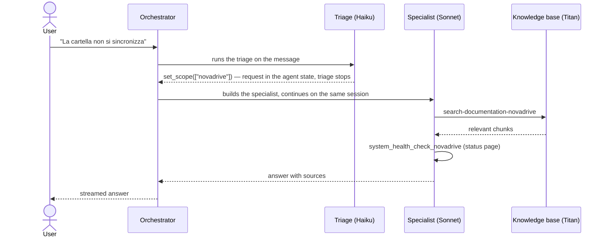

# NovaCloud Support Agent

Blueprint of a **multi-agent customer support assistant** on
[Strands Agents](https://strandsagents.com) and **Amazon Bedrock**. Main features:
- agents that hand the turn over to each other;
- RAG with semantic embeddings;
- fallbacks between models;
- configuration kept apart from the code;
- quality measured with a benchmark.

Fictional domain: **NovaCloud**, with three products: NovaID (account), NovaDrive (cloud files) and
NovaBill (billing). Code and documentation are in English; the demo content (knowledge base,
prompts, benchmark datasets) is in Italian, the language the assistant speaks.

## How it works

A **triage** agent understands which product the user is talking about and hands the turn over to a
**specialist**, which searches the documentation, checks the status of the services and opens
tickets when needed. If the topic changes, the specialist hands the turn back to the triage.
Everything happens within the same turn: the user sees a single answer.



Agents never talk to each other or to the user: they signal through their tools, and the
orchestrator decides every handover and streams the answer.

The complete component diagram is at the end of the [code guide](docs/guide.md).

## Prerequisites

You need Python 3.12+ (`make setup` and the CI use 3.13), [uv](https://docs.astral.sh/uv/) and AWS credentials with
[Bedrock model access](https://docs.aws.amazon.com/bedrock/latest/userguide/model-access.html) in
`eu-west-1` for Claude Sonnet 4.5, Claude Haiku 4.5, Titan Text Embeddings V2 and, for the benchmark
judge, Mistral Pixtral Large and Mistral Large.

## Running it

Run the commands from the project folder, in this order the first time.

### 1. Setup

Create the virtualenv with the pinned dependencies:

```bash
make setup
```

Point to your AWS credentials (for an SSO profile, log in first):

```bash
export AWS_PROFILE=your-profile
```

```bash
aws sso login --profile your-profile
```

### 2. Tests (offline, no AWS)

```bash
make test
```

### 3. Knowledge base

Build the index of `data/kb/` with Titan (needed before the first chat, and after every change to
the documents):

```bash
make ingest
```

Search the existing index of one product, as the search tool of the agent does (no rebuild):

```bash
make search Q="mi ridate i soldi del piano annuale?" SCOPE=novabill
```

### 4. Chat

Chat through the triage, as a customer would (`/state` shows the chat state, `/exit` quits):

```bash
make chat
```

Chat with the product fixed by the caller, so no triage and no rerouting:

```bash
.venv/bin/python -m agent.cli --scope novadrive
```

Start or resume a chat with a chosen id:

```bash
.venv/bin/python -m agent.cli --chat-id demo-1
```

### 5. Evaluation

Evaluate the retrieval alone, for several thresholds (embedding calls only, a few seconds):

```bash
make bench-retrieval
```

Run the agent benchmark with the LLM judge (about 3 minutes):

```bash
make bench
```

Run the agent benchmark with the deterministic metrics only, no judge:

```bash
make bench-offline
```

Run a single scenario, without the judge:

```bash
.venv/bin/python -m benchmark.cli --scenario rerouting_drive_to_bill --no-judge
```

### 6. Inspect what happened

The application log:

```bash
tail -f var/logs/blueprint.log
```

The stored chats (phase, scopes, messages, tools used), the opened tickets and the benchmark reports:

```bash
ls var/chats var/tickets var/benchmark_runs
```

## Usage examples

1. **Routing**: "La cartella NovaDrive sul pc non si sincronizza". The NovaDrive specialist also
   reports the ongoing slowdown, read from the status page.
2. **Simulated incident**: with the chat open, set `downtime` on a resource in
   `data/systems_status.json` and ask again.
3. **Several products**: "Ho cambiato password e l'app NovaDrive non mi fa entrare" → two scopes,
   NovaDrive + NovaID.
4. **Rerouting to another agent**: after a NovaDrive question, ask "come scarico la fattura?".
5. **Ticket**: report a double charge and give a name and an email.

## Configuration

Behaviour changes without touching the code.

| What | Where | When the change applies |
|---|---|---|
| models and fallbacks of every role | `config/models.json` | at restart |
| products and their tools | `config/scopes.json` | at restart |
| embedder and chunking | `config/knowledge_base.json` | at the next `make ingest`; until then the agent refuses to start if the embedding model changed |
| retrieval (`top_k`, `min_score`) | `config/knowledge_base.json` | at restart |
| agent behaviour | `prompts/*.md` | at the next turn |
| documentation | `data/kb/<product>/*.md` | after `make ingest` and a restart |
| service status | `data/systems_status.json` | immediately |

Optional environment variables:
- `BLUEPRINT_CONTEXT_WINDOW_SIZE`: context window, 20 messages by default;
- `BLUEPRINT_RUNTIME_DIR`: folder of the generated state, `var/` by default;
- `BLUEPRINT_LOG_LEVEL`: level of the file log;
- `BLUEPRINT_HOME`: root of the project.

## Documentation

- [Code guide](docs/guide.md): the path of a turn, the non-obvious parts, how to extend, component
  diagram.
- [Architecture decisions](docs/decisions/): seven choices, with alternatives and consequences.
- [Towards production](docs/production.md): what to replace and what to add for a real deployment.

## Known limitations

- Specialists use Sonnet: slower and more expensive than Haiku.
- The Mistral judge is independent of the agents, but less strict than Sonnet on blatant errors.
- File-based stores meant for a single process.
- Titan gets one call per chunk: fine for dozens of documents, not for thousands.
- The benchmark datasets are small: enough for a demo, a production system needs more cases.

## License

[MIT](LICENSE)
