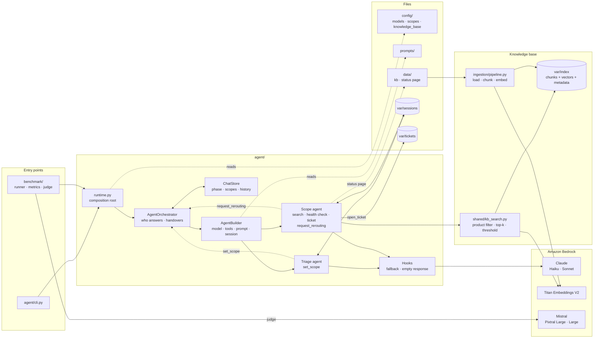

# Code guide

## Main modules

`agent` is the product, `ingestion` builds the knowledge base, `benchmark` measures the quality of
the answers, `shared` holds what the modules have in common. The configuration is in `config/`
(models, products, knowledge base), `prompts/` and `data/`; the state generated at runtime in `var/`.

## The path of a turn

1. **Startup**: `agent/runtime.py` creates and wires every component. It is the only wiring point;
   classes receive their dependencies ready to use ([0004](decisions/0004-composition-root-and-toolkits.md)).
2. **Who answers**: `AgentOrchestrator.current_agent`. Scopes fixed by the caller → specialist; chat
   already in the `scope` phase → specialist; otherwise → triage.
3. **Build**: `AgentBuilder` builds the agent with the models of its role, the tools of its toolkit,
   the composed system prompt and the session of the chat. Every turn and every handover builds the
   agent from the session: the orchestrator keeps no agent in memory. In a chat only one agent runs
   at a time: triage and specialist take turns on the same session, never in parallel. A specialist
   can cover several products at once (up to 2), with the tools and instructions of each.
4. **Handover**: `set_scope` (triage) and `request_rerouting` (specialist) write the request into
   the agent state and stop the agent. The orchestrator builds the other agent and lets it continue
   with `stream_async(None)` in the same turn. At most one rerouting per turn
   ([0001](decisions/0001-explicit-orchestrator.md)).
5. **Events**: `TurnRecorder` turns the Strands events into `TextDelta`, `ToolStarted`, `Handover`,
   `TurnCompleted`. Every text chunk says which agent wrote it: the CLI streams the specialist and
   holds back the triage text until the turn ends, so a preamble before a handover is never shown.
   The benchmark reads only the last event.
6. **Persistence**: the answer goes to the chat history (`ChatStore`), the model state to the Strands
   session ([0003](decisions/0003-two-memories.md)).

## Details

- **History projection** (`agent/history_projection.py`): every agent sees as text the past calls to
  tools it does not have ([0002](decisions/0002-shared-session.md)).
- **Two flags for the rerouting tool**: `rerouting_enabled` tells whether the specialist has the
  tool; `rerouting_allowed`, in the agent state, tells whether it can still use it in this turn.
- **Tools** (`agent/toolkits.py`): every tool is a `build()` function; products declare their tools
  in `config/scopes.json`, and `PRODUCT_TOOL_BUILDERS` is the complete list.
- **Fallback** (`agent/hooks/model_retry.py`): moves to the next model only on transient errors. A
  configuration error reaches the caller ([0005](decisions/0005-models-per-role.md)).
- **RAG** (`ingestion/pipeline.py`, `shared/kb_search.py`): one chunk per section with the path of
  its headings, split at paragraphs and sentences; parallel embedding with retries; the index is
  swapped in atomically. The index is data only (`chunks.json`, `vectors.npy`, `index_meta.json`).
  The metadata record model and dimensions, and at startup `check_compatibility` compares them with
  the configuration: on a mismatch the agent stops and asks for `make ingest`
  ([0006](decisions/0006-rag.md)).
- **When a change applies**: `config/` at restart, and embedder or chunking only after `make ingest`;
  `prompts/` at the next turn, because every turn rebuilds the agent; the documents after `make ingest`
  and a restart; the status page immediately.

## Benchmark and tests

- `make bench` runs scripted conversations on the real orchestrator, with deterministic metrics
  (routing, escalation, tools) and a structured judge ([0007](decisions/0007-evaluation.md)).
- `make bench-retrieval` measures the retrieval alone (recall@1, recall@5, MRR, rejection of
  off-domain queries) for several thresholds: that is where `min_score` comes from.
- `make test` runs 83 offline tests. The orchestrator is tested with scripted agents
  (`tests/integration/test_orchestrator.py`), the ingestion with a fake embedder (`tests/fakes.py`).

## Extending

- **New product**: add it to `config/scopes.json`, write `data/kb/<id>/*.md` (frontmatter with
  `title` and `url`) and `prompts/scope_additional_infos_<id>.md`, then `make ingest`. Prompts and
  `set_scope` read the catalog on their own.
- **New tool**: create a module in `agent/tools/` with a function
  `build(*, scope, chat_ctx, services) -> ToolSpec`. Then add it to `PRODUCT_TOOL_BUILDERS` and to
  `ProductToolName`, and declare it in `config/scopes.json`.
- **New model provider**: a class in `agent/model_providers/` and an entry in
  `model_factory.PROVIDERS`. For other backends there is already `litellm`, after
  `pip install "strands-agents[litellm]"`.
- **Another embedder**: implement the `shared.embeddings.Embedder` protocol (`name`, `model_id`,
  `dimensions`, `embed_documents`, `embed_query`), describe its settings in `EmbedderConfig`
  (`shared/kb_config.py`, today shaped for Titan) and return it from `create_embedder`. Then run
  `make ingest` and `make bench-retrieval` to choose a new `min_score`: every model has its own
  similarity scale.

## Architecture diagram

Solid arrows are calls; dashed arrows are reads, of files or of the agent state. `set_scope` and
`request_rerouting` do not call the orchestrator: they leave a request in the agent state, which the
orchestrator reads when the agent stops. The two agents share the same session, never talk to each
other and never talk to the user; the orchestrator decides by reading `ChatStore`.
